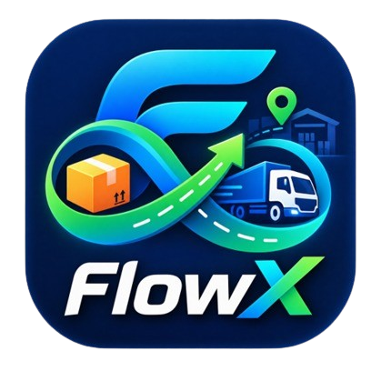

# FlowX

**Less dead stock. Fewer empty miles.**  
FlowX connects surplus inventory and buyer requests with available transport capacity, making it easier to see a potential match before a seller accepts.

<p align="center">
  
</p>

<p align="center">
  <a href="https://flowx-phi.vercel.app/"><strong>Open the live demo</strong></a>
</p>

## Screenshots

The dashboard screenshot shows the sample-data scenario. The seller screenshot shows suggested transport matches and a request without a suitable truck.

| Dashboard | Seller requests and transport matches |
|---|---|
|  |  |

## What it does

FlowX is a browser-based prototype for coordinating:

- **Surplus inventory:** sellers list a product, quantity, pickup location, and price.
- **Buyer demand:** buyers browse listings and send requests with a delivery location.
- **Available transport:** transporters add vehicles, routes, capacity, and price.
- **Rule-based matching:** pending seller requests show a suitable available vehicle, estimated capacity utilization, and transport price before acceptance.
- **Deal records:** accepting a request deducts inventory and vehicle capacity and records a transaction.

On the dashboard, choose **Load Sample Data** for an example with rice in Bilaspur, a truck to Raipur, and several requests. One request intentionally has no matching route. Loading the sample replaces the current demo records. **Reset Demo Data** clears them after confirmation.

## Run locally

FlowX is a static HTML, CSS, and JavaScript app. It has no package manager, build step, or dependencies to install.

1. Open a terminal in the project folder.
2. Start Python's built-in local web server:

   ```bash
   python -m http.server 8000
   ```

   On Windows, `py -m http.server 8000` may be used if the Python launcher is installed.
3. Open [http://localhost:8000](http://localhost:8000) and select **Load Sample Data** on the dashboard.
4. To stop the server, press `Ctrl+C` in the terminal.

You can also open `index.html` directly in a browser, but running a local server is the more consistent option.

## Current limitations

FlowX is an early functional prototype, not a production marketplace.

- **Local, browser-specific data:** records are stored in `localStorage`. They are not shared across users, browsers, or devices.
- **No accounts or backend:** there is no central database, authentication, role-based access, or server-side validation.
- **Basic matching rules:** matching checks exact normalized pickup and delivery city names and compatible capacity in kg or tonnes. It prioritizes higher vehicle utilization, then lower price on a tie; it does not calculate road distance or optimize routes.
- **Suggestions are not reservations:** a suggested vehicle can become unavailable or change as other requests are accepted. The seller must accept the request to deduct stock and capacity.
- **No live operations integrations:** GPS tracking, carrier verification, messaging, integrated payments, and settlement are not implemented.
- **Prototype data and impact:** sample entries are illustrative. Savings, emissions reductions, and commercial outcomes have not been validated through a pilot.

## Technology

- HTML
- CSS
- Vanilla JavaScript
- Browser `localStorage` for demo data

## Project status

FlowX is an early-stage prototype focused on demonstrating the inventory, buyer-request, and transport-matching workflow. The live demo is available at [flowx-phi.vercel.app](https://flowx-phi.vercel.app/).
